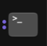

# Python Intro
## Linux based & Terminal Focused

A hands-on introduction to Python, from installing it to writing your first programs. Work through the sections in order, and use the notebooks to practice each new concept.

## Who this tutorial is for

This tutorial is for beginners. You don't need any previous programming experience. It is for those who prefer a written, interactive experience, as well as a focus on CLI practice. You can find many videos, online apps, courses, etc., but this is the dead-simple tutorial I would have wanted starting out, because I just hate buttons.

### My personal case for CLI-focused methods

Buttons seem like the easy way, GUI seems like the easy way, videos and AI seem like the easy way. But the comfort and predictability that come from basic CLI operation become so much easier once you practice.

For example, to create a file:

- CLI: `touch "file1"`
- GUI: right click > select add file > type in file1

I know, hot keys and using copy and paste functions can help, and there's no reason to avoid GUI entirely. However, the CLI is a basic skill that allows you to understand the logic in a tool-agnostic way. It is easier to learn programs when you actually understand the underlying code, but also the structure.

### Another personal opinion regarding FOSS

We use Microsoft and Google every day, and everything we do runs on AWS or Azure. There is no way to escape the giants dominating the landscape, and no reason not to enjoy the fabulous tech they create. All of these companies also support open source initiatives and champion young technologies through investment and development.

However, it can be easy to get tunnel vision, so I think it is important to encourage diverse systems, competition, and open source. The implications go beyond tech and are something everyone should educate themselves about.

## What you'll need

- A PC running Linux
- A terminal or command prompt
- Python 3
- A code editor or notebook environment

## Learning path

1. Install and check Python
2. Set up a project and virtual environment
3. Work through the notebooks in order
4. Complete the practice checklist
5. Try the mini-projects

## 1. Install Python

### Open a terminal

- Open your terminal application.
  - Tip: check your settings > keyboard > shortcuts > launcher settings. For me, I can use `super+x` to launch the terminal.
  - GUI users look for this icon:

    

### Check whether Python is installed

Try:

```bash
python3 --version
```

For me, this returns:

```text
Python 3.14.4
```

### Install Python

If you do not have a current install, use:

```bash
sudo apt install python3 python-is-python3
sudo apt update && sudo apt upgrade
```

The `python-is-python3` package will make sure `python` points to `python3`. Updating and upgrading ensures the rest of your system doesn't miss dependencies based on the new install.

## Create a directory

You've installed Python! Now what? Well, most people start with Jupyter notebooks. They are files with an `.ipynb` extension, and like all files, you need a place to put them.

Back to the terminal. You can also use the terminal in VS Code or Zed, if you want a GUI experience. At this point, I normally do. In both, this is how to open the terminal:

``ctrl+shift+` ``

Usually your terminal opens on your home directory under your user. To get back here at any time you can use `cd ~`. `cd` is how we navigate in the terminal (change directory). If you want your directory (folder) here, then stay here to create it, otherwise navigate to where you want it.

```bash
cd chosen-folder
cd "folder with spaces"
cd ..  # go up a level
```

Then create your project folder with a notebooks folder inside it, and move into it:

```bash
mkdir -p python-intro/notebooks
cd python-intro
```

The `-p` flag creates `python-intro` first if it does not exist yet. Now you have a root directory (`python-intro`) and a directory for your notebooks.

## Create a Virtual Environment

To keep all of the dependencies in order, we will create a virtual environment.

```bash
python -m venv .venv
```

I am on Ubuntu. If you are as well, you may get this message:

```text
The virtual environment was not created successfully because ensurepip is not
available.  On Debian/Ubuntu systems, you need to install the python3-venv
package using the following command.

    apt install python3.14-venv
```

Generally, you are not the root user, so you need to add `sudo`. Usually, after adding a package it is a good idea to run an apt upgrade.

```bash
sudo apt install python3.14-venv
sudo apt update && sudo apt upgrade
```

Type `y` to accept updates. Then run `python -m venv .venv` again.

Once you have created the venv, you might wonder, where is it? When you ran the cmd, it created several new folders and files, and now your directory should look more like this:

```text
python-intro
├── .venv
│   ├── bin
│   ├── include
│   ├── lib
│   ├── lib64
│   └── pyvenv.cfg
└── notebooks
```

### Activate your venv

So, we have the installation done, and we have created our venv. To activate, use `source .venv/bin/activate`. You can see this file in the directory. Once you have activated your venv, your command line path will show (.venv) in front of it, something like `(.venv) user@computer:~/python-intro$`. To deactivate, simply type `deactivate`. Nothing fancy needed.

## Notebook No.1

*Button alert, pick your poison. Jupyter in the browser requires some mods to have dark mode (I am a vitamin D deficient nerd and this is critical for me), and in my opinion, has more button click-throughs than VS Code.*

### Pick your path

| | Zed | VS Code | Browser |
|---|---|---|---|
| File type | `.py` | `.ipynb` | `.ipynb` |
| Extra installs | `ipykernel` + kernel | 2 extensions | `notebook` package |
| Launch | `zed .` | `code .` | `jupyter notebook` |
| Run a block | `repl: run` in the command palette | Play button | `shift+enter` |
| Kernel | `python-intro` | `.venv` or `python-intro` | `Python 3 (ipykernel)` or `python-intro` |

### Bash to Editor Paths

Confirm with `pwd` that you are still in `python-intro`, or in `python-intro/notebooks` if you only want to see the notebooks in the editor.

#### Zed

##### Open & set up Zed from the terminal

*Zed currently has limited support for notebooks, but allows you to use REPL to run code in a .py (instead of .ipynb). For learning, this is a great way to see what are essentially notebooks without the fancy skin.*

- Zed uses `zed --classic` to launch, but I typed in `zed .` and it prompted me to add that as an alternate as well
- To open your terminal in Zed or VS Code, use ``ctrl+shift+` ``

In Zed, we will use a .py file, not a notebook file. Zed does not have native notebook support, but it does have REPL, which will allow us to run our code in a similar way. To run REPL on code, we need a Jupyter kernel as well as our venv.

Check that you still see (.venv) in your command line. If not, activate it again with `source .venv/bin/activate`.

```bash
which python
```

This should output a path ending in `python-intro/.venv/bin/python`.

```bash
pip install ipykernel
python -m ipykernel install --user --name pyintro --display-name "python-intro"
```

##### Create your notebook and run your first code in Zed

```bash
touch zed-nb-1.py
```

- Open `zed-nb-1.py` and type:

```python
# First Zed Run
print("Hello World")
```

- Select the text and hit `ctrl+shift+p` to open the command palette, then type to select "repl: run".
- You should see a new block with "Hello World" printed.

Now you have your kernel running and a .py for your code. You can execute your code via the command palette (`ctrl+shift+p`) and selecting `repl: run`. To add comments, use `#` before the comment on a new line.

In this path, you may deactivate the .venv and you won't have to start it again. The kernel uses it, and it is a static file, so there is no additional deactivation there. Try it yourself: `deactivate`, then run the code.

#### VS Code

##### Open VS Code & set up from the terminal

- VS Code uses `code .` to launch
- To open your terminal in Zed or VS Code, use ``ctrl+shift+` ``

*To use notebooks in VS Code, you need extensions. To install these extensions, you can wait to be prompted in the GUI when running the code, or use your terminal:*

```bash
code --install-extension ms-toolsai.jupyter
code --install-extension ms-python.python
```

Check that you still see (.venv) in your command line. If not, activate it again with `source .venv/bin/activate`.

```bash
which python
```

This should output a path ending in `python-intro/.venv/bin/python`.

##### Create your notebook and run your first code in VS Code

*Button alert: creating from the command palette creates an untitled .ipynb, which you will then need to save via the file explorer, which will open in your ~ home directory. Our `touch` method also will not create the first block. See the echo method to blend the best of both worlds.*

- Option 1: add your notebook to the notebooks directory. Press `ctrl+shift+p` to open the command palette and search for "Create: New Jupyter Notebook".
- Option 2: the method we used for Zed, `touch vscode-nb-1.ipynb`, will create the file but it will not start with a "starter block" and you will have to add the first code block.
- Option 3: create a non-empty notebook from the CLI:

```bash
echo '{"cells":[{"cell_type":"code","execution_count":null,"metadata":{},"outputs":[],"source":[]}],"metadata":{"kernelspec":{"name":"pyintro","display_name":"python-intro","language":"python"}},"nbformat":4,"nbformat_minor":4}' > notebooks/vscode-nb-1.ipynb
```

Notebooks are JSON under the hood, so this creates the file where you want it in the directory, with the kernel name already filled in. (fewer buttons = good)

- Open the notebook in the editor and type this in the first block:

```python
# First VS Code Run
print("Hello World")
```

When you click the "Play" button to run the code, you will see the command palette open with your .venv to select. This will connect your environment to the notebook.

### Bash & browser path

#### Install and open Jupyter in the browser

If you stayed in the terminal, congratulations, you are super cool! Install the notebook package in your venv:

```bash
pip install notebook
cd notebooks  # if not already there
```

Check which Jupyter you are about to launch. The path should contain `.venv`:

```bash
which jupyter
```

Then type `jupyter notebook` to open the Jupyter interface in your browser.

#### Create your notebook and run your first code in the browser

A kernel is the program that actually runs your code. The notebook is just the front end, which is why Zed, VS Code, and the browser can all share the same kernel.

In the browser, click New in the top right. Under "Notebook:" you will see two kernels. `Python 3 (ipykernel)` is the default that installing `ipykernel` adds inside your venv, and it relies on your venv being active when you launch Jupyter. `python-intro` is the one you registered, and it stores the full path to your venv's Python, so it works with the venv off. Either one is fine here.

- Pick a kernel to open a new notebook, and type this in the first cell:

```python
# First Browser Run
print("Hello World")
```

- Press `shift+enter` to run the cell. The output appears below it.
- To skip the New menu, create the file with the echo method above (run from `python-intro`), then click it in the file list.

To stop the server, go back to the terminal and press `ctrl+c`, then `y` to confirm.

## References

- [Installing Python](https://python.land/installing-python)
- [Basic Linux Terminal Shortcuts](https://computingforgeeks.com/basic-linux-terminal-shortcuts-cheat-sheet/)
- [ipykernel](https://pypi.org/project/ipykernel/)
- [Jupyter Notebooks](https://jupyter.org/)
- [Zed repl](https://zedhub.dev/repl)
- [VSCode](https://code.visualstudio.com/)
- [Linux Echo file](https://linuxvox.com/blog/linux-echo-file/)
- [Source in Linux](https://linuxvox.com/blog/source-in-linux/)
- [Lots of options compared to VSCode](https://alternativeto.net/software/visual-studio-code/?platform=linux)

## AI Use

```text
Copilot Code and Claude chat were used for brainstorming and formatting/proofing materials in this repo. None of the content originated from these programs, and everything was reviewed by me, a human.

Content generated from AI will be marked (I frequently use it for translation purposes).
```

## MIT License

Copyright (c) 2026 Kat Keilty

Permission is hereby granted, free of charge, to any person obtaining a copy of this software and associated documentation files (the “Software”), to deal in the Software without restriction, including without limitation the rights to use, copy, modify, merge, publish, distribute, sublicense, and/or sell copies of the Software, and to permit persons to whom the Software is furnished to do so, subject to the following conditions:

The above copyright notice and this permission notice shall be included in all copies or substantial portions of the Software.

THE SOFTWARE IS PROVIDED “AS IS”, WITHOUT WARRANTY OF ANY KIND, EXPRESS OR IMPLIED, INCLUDING BUT NOT LIMITED TO THE WARRANTIES OF MERCHANTABILITY, FITNESS FOR A PARTICULAR PURPOSE AND NONINFRINGEMENT. IN NO EVENT SHALL THE AUTHORS OR COPYRIGHT HOLDERS BE LIABLE FOR ANY CLAIM, DAMAGES OR OTHER LIABILITY, WHETHER IN AN ACTION OF CONTRACT, TORT OR OTHERWISE, ARISING FROM, OUT OF OR IN CONNECTION WITH THE SOFTWARE OR THE USE OR OTHER DEALINGS IN THE SOFTWARE.
